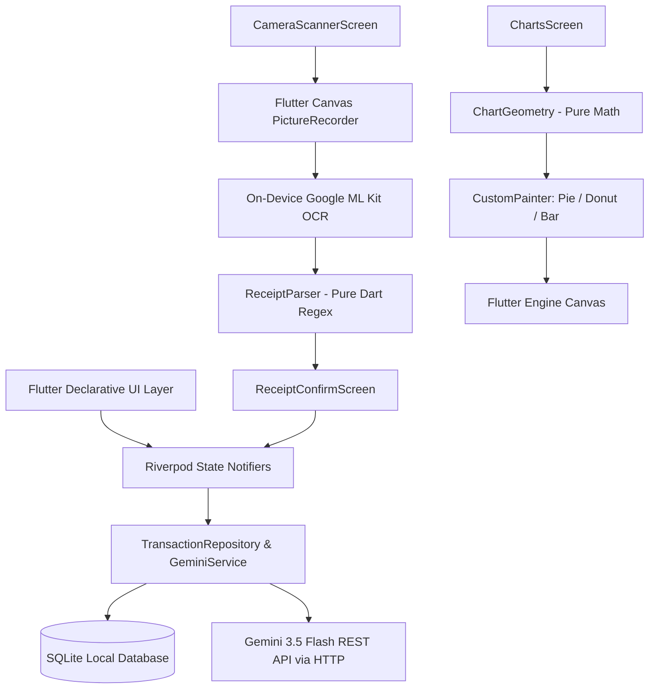

# MINI-PROJECT SHORT TECHNICAL REPORT
**Course:** Cross-Platform Mobile App Development (VKU)  
**Mini-Project Title:** Mini-Project 3: Expense Tracker with OCR Receipt Scanning & Gemini AI Assistant  
**Team / Student Name:** Lê Thị Hương Giang  
**Student ID:** 23IT.B044  
**Submission Date:** 25/10/2026  

---

## 1. GENERAL INFORMATION & DELIVERABLE LINKS
* **Team Members:**
  1. Lê Thị Hương Giang - Student ID: 23IT.B044 - Role: Mobile App Developer & UI Designer - Contribution: 100%
* **🔗 Live Demo URL (APK):** [https://github.com/lethihuonggiang-2907/danentang_project3/releases/download/v1.0/app-release.apk](https://github.com/lethihuonggiang-2907/danentang_project3/releases/download/v1.0/app-release.apk)
* **💻 GitHub Repository:** [https://github.com/lethihuonggiang-2907/danentang_project3](https://github.com/lethihuonggiang-2907/danentang_project3)
* **🎥 Video Demo:** [https://drive.google.com/drive/folders/1Ze-VANbmcFmK8kSbbxmoTtjtP_3ggnX1?usp=sharing](https://drive.google.com/drive/folders/1Ze-VANbmcFmK8kSbbxmoTtjtP_3ggnX1?usp=sharing)
* **📸 Báo cáo hình ảnh riêng biệt (Standalone Screenshots Doc):** [docs/SCREENSHOTS.md](docs/SCREENSHOTS.md)

---

## 2. FEATURE IMPLEMENTATION CHECKLIST
| # | Required Feature | Status | Implementation Details & Acceptance Level |
|:---:|---|:---:|---|
| 1 | **Image Picking & Live Camera** | ✅ Complete | Live camera preview with `camera` package (`CameraScannerScreen`), tap-to-focus/exposure with animated ring (`FocusRingWidget`), 3-mode flash toggle (Off/Auto/Torch), crop-frame overlay (`CameraCropOverlay`), and gallery picker fallback (`image_picker`). |
| 2 | **On-Device Offline OCR** | ✅ Complete | Fully offline on-device text recognition using Google ML Kit (`google_mlkit_text_recognition`). Measures and logs processing time in milliseconds (`OcrScanResult.durationMs`). Generates and persists max-300px thumbnails in app documents directory. |
| 3 | **Vietnamese Heuristic Regex Extraction** | ✅ Complete | Pure Dart `ReceiptParser` (0 Flutter dependencies). Normalizes accents, parses Vietnamese VND currency formats (periods, commas, spaces, unit words như `triệu`, `k`, `tr`), prioritizes total keywords, ignores VAT/change/discounts/phone numbers, corrects OCR character confusion (O↔0, l/I↔1), and extracts transaction dates with calendar validation and merchant/beneficiary names. |
| 4 | **Review & Edit Screen before Saving** | ✅ Complete | `ReceiptConfirmScreen` allows reviewing and modifying amount, date, category, merchant, and notes. Features live thousand-separator input formatting, displays thumbnail and OCR latency badge, and includes an expandable raw OCR text accordion for verification. |
| 5 | **SQLite Persistence & Category Filters** | ✅ Complete | `DatabaseHelper` and `TransactionRepository` using `sqflite` with parameterized queries, indices, and migration stubs. Transactions table stores `id`, `amount`, `date`, `merchant`, `category`, `note`, `thumbnail_path`, `created_at`. Deleting a transaction cleans up thumbnail files on disk. Includes swipe-to-delete with confirmation and category filter chips. |
| 6 | **CustomPainter Charts (No 3rd-party pkgs)** | ✅ Complete | Pure math `ChartGeometry` engine computing sweep angles summing to $2\pi$ and bar rectangles. Custom painters for Pie Chart, Donut Chart (with central total), and 7-day Weekly Bar Chart (with week navigation). Interactive tap selection, value pills, category legend, and entrance animations via `AnimationController`. |
| 7 | **Comprehensive Testing Suite** | ✅ Complete | **75 automated tests** at the time of writing covering ReceiptParser table-driven cases (38 simulated receipt & banking formats), ChartGeometry mathematical proofs, CropGeometry coordinate mapping, SQLite models, CustomPaint widgets, and Gemini mock HTTP calls. `flutter analyze` clean with 0 warnings/errors. |
| 8 | **Gemini AI Spending Assistant** | ✅ Complete | REST integration with Google Gemini (`gemini-3.5-flash`) using plain `http` and `connectivity_plus`. Injects API key via `--dart-define=GEMINI_API_KEY`. Strict privacy guard sends **only aggregated numerical statistics** (totals per category, daily sums, week-over-week change; never sends images, merchants, or notes). Evaluates spending level, analyzes changes, and suggests 2-3 weekly goals with offline, thinking budget control, and error handling. |

---

## 3. TECHNICAL ARCHITECTURE & PROJECT STRUCTURE

### 3.1 Architecture Overview
The application follows a **Feature-First Modular Architecture**, strictly adhering to Separation of Concerns:
* **`core/`**: Shared theme (Material 3 Light/Dark), constants, input formatters.
* **`data/`**: SQLite database helper, repository pattern, data models.
* **`features/`**: Independent feature modules (`scanner`, `extraction`, `transactions`, `charts`, `ai_assistant`).
  * `extraction/receipt_parser.dart` is written in **Pure Dart** with no Flutter imports to ensure deterministic unit testing.
  * `charts/geometry/chart_geometry.dart` is a **pure mathematical engine** separated from UI painting.

### 3.2 Framework, Engine & Embedder Architecture Layers
1. **Framework Layer (Dart):** Implements declarative UI widgets, state management (Riverpod), animation controllers, and high-level business logic.
2. **Engine Layer (C++):** Houses the graphics pipeline (Skia/Impeller), text layout (HarfBuzz), Dart Virtual Machine, and native Canvas drawing routines utilized by our `CustomPainter` and `PictureRecorder`.
3. **Embedder Layer (Platform Native - Java/Kotlin/Android NDK):** Connects the Flutter Engine to the Android OS, hosting the Camera2 API preview texture, local file storage, SQLite access via Android SQLite drivers, and Google ML Kit vision libraries.

---

## 4. EMPIRICAL EVIDENCE & SCREENSHOTS

> 📌 **Tài liệu riêng biệt:** Toàn bộ hình ảnh minh chứng giao diện thực tế cùng phân tích chuyên sâu đã được tách thành một file riêng: **[docs/SCREENSHOTS.md](docs/SCREENSHOTS.md)**.

### Tóm tắt danh mục hình ảnh minh chứng thực tế:

| Hình số | Tên chức năng / Giao diện | Mô tả tóm tắt | Liên kết tài liệu chi tiết |
|:---:|---|---|:---:|
| **Hình 1** | **Camera Scanner & Crop Frame** | Khung quét trực tiếp, 4 góc xanh ngọc căn chỉnh hóa đơn, nút chụp, đèn flash và chọn ảnh từ thư viện. | [Xem chi tiết tại docs/SCREENSHOTS.md](docs/SCREENSHOTS.md#hình-1-màn-hình-quét-hóa-đơn-qua-camera-camera-scanner-screen) |
| **Hình 2** | **Danh sách giao dịch chi tiêu** | Banner tổng chi tiêu `924.000 ₫`, chip lọc danh mục, thẻ giao dịch hiển thị thumbnail ảnh thu nhỏ và số tiền. | [Xem chi tiết tại docs/SCREENSHOTS.md](docs/SCREENSHOTS.md#hình-2-danh-sách-giao-dịch--bộ-lọc-danh-mục-transaction-list-screen) |
| **Hình 3** | **Biểu đồ tròn (CustomPainter Pie)** | Biểu đồ tròn vẽ bằng thuật toán Canvas thuần không thư viện ngoài, bảng tỷ lệ phần trăm danh mục. | [Xem chi tiết tại docs/SCREENSHOTS.md](docs/SCREENSHOTS.md#hình-3-biểu-đồ-tròn-tỷ-lệ-chi-tiêu-custompainter-pie-chart) |
| **Hình 4** | **Biểu đồ Donut & Chạm chọn vùng** | Biểu đồ Donut với tâm hiển thị chi tiết số tiền khi chạm vào từng phân khúc (Hit-testing tọa độ cực). | [Xem chi tiết tại docs/SCREENSHOTS.md](docs/SCREENSHOTS.md#hình-4-biểu-đồ-donut--tương-tác-chạm-chọn-vùng-custompainter-donut-chart) |
| **Hình 5** | **Biểu đồ cột chi tiêu tuần (Bar)** | Biểu đồ cột 7 ngày trong tuần (T2-CN), kèm bộ điều hướng tuần trước/tuần sau mượt mà. | [Xem chi tiết tại docs/SCREENSHOTS.md](docs/SCREENSHOTS.md#hình-5-biểu-đồ-cột-chi-tiêu-7-ngày-trong-tuần-weekly-bar-chart) |
| **Hình 6** | **Trợ lý tài chính thông minh Gemini AI** | Kết quả phân tích từ `gemini-3.5-flash`: Đánh giá mức độ chi tiêu, nhận xét biến động và 3 mục tiêu tuần tới. | [Xem chi tiết tại docs/SCREENSHOTS.md](docs/SCREENSHOTS.md#hình-6-trợ-lý-tài-chính-thông-minh-gemini-ai-gemini-ai-spending-assistant) |

---

## 5. TECHNICAL CHALLENGES & RESOLUTIONS

### Challenge 1: Resilient Heuristic Regex Parsing of Vietnamese Receipts with OCR Noise
* **Problem:** Vietnamese receipts printed on thermal paper and mobile banking transfer screenshots present substantial OCR noise:
  1. Digits are frequently misrecognized by ML Kit (e.g. `O`/`o` instead of `0`, `l`/`I` instead of `1`, and random spaces inserted inside numbers like `1 50. 000`).
  2. Diverse currency formats (`150,000 VND`, `150.000đ`, `1.250.000 VNĐ`, `150000`, cùng các từ chỉ đơn vị tiền tệ như `triệu`, `k`, `tr`, `nghìn`).
  3. Misleading monetary lines (subtotals, VAT, customer payment, change returned, or phone numbers in headers) frequently have larger numbers than the actual total.
* **Resolution:**
  1. Implemented a Vietnamese diacritics stripping function (`_normalize`) mapping accented characters to ASCII uppercase for consistent keyword matching.
  2. Implemented iterative character sanitization replacing `O`/`o` and `l`/`I` when adjacent to digits or decimal points, collapsing internal whitespace, and stripping non-monetary sequences (phone numbers like `+84 912 345 678`).
  3. Built a unit-word scaling engine recognizing `triệu` ($\times 1,000,000$), `k`/`tr` ($\times 1,000$) to accurately extract numbers written colloquially.
  4. Enforced prioritized keyword matching (`TỔNG CỘNG`, `TỔNG TIỀN`, `THÀNH TIỀN`, `TỔNG THANH TOÁN`, `SỐ TIỀN`, `TOTAL`, `AMOUNT`) while explicitly ignoring lines containing `VAT`, `THUẾ`, `TIỀN KHÁCH ĐƯA`, `TIỀN THỪA`, `GIẢM GIÁ`, `CHIẾT KHẤU`.
  5. Verified parsing correctness across 38 table-driven test cases covering Vietcombank, MB Bank, Techcombank, MoMo, and invalid calendar date rejection.

### Challenge 2: Pure Canvas Geometry & Coordinate Mapping Without External Chart Libraries
* **Problem:** The course project strictly prohibits external chart packages (e.g. `fl_chart`), requiring mathematical computation from scratch on Canvas:
  1. Ensuring the sum of sweep angles for Pie/Donut charts strictly equals $2\pi$ radians without floating-point drift or divide-by-zero crashes on empty/zero data.
  2. Detecting which slice or bar is tapped (`hit-testing`) in polar and Cartesian coordinate spaces.
  3. Mapping screen-space crop frames to image pixel rectangles during live camera capture across varying camera aspect ratios.
* **Resolution:**
  1. Created `ChartGeometry` which normalizes positive category sums and assigns the remainder $(2\pi - \sum \text{sweep}_{0..n-1})$ to the final slice, guaranteeing mathematical closure. Handled single-category ($2\pi$) and empty datasets cleanly.
  2. Formulated polar angle hit-testing via `atan2(dy, dx)` normalized relative to slice start angles, bounded by inner and outer radii.
  3. Created `CropGeometry.mapScreenCropToImagePixels` computing `BoxFit.cover` scale factors and coordinate clamping, verified through automated unit tests.

### Challenge 3: Gemini 3.5 Flash Reasoning Migration, Thinking Token Budgeting & Multi-Part Truncation
* **Problem:**
  1. Google shut down older Gemini 1.5/2.5 Flash endpoints, necessitating migration to the newer reasoning model `gemini-3.5-flash`.
  2. `gemini-3.5-flash` introduces internal chain-of-thought tokens (hidden thinking tokens). Under a default `maxOutputTokens: 800` configuration, the model consumed over 270 thinking tokens internally, exhausting the token budget before finishing the output, triggering `finishReason: MAX_TOKENS` and abruptly cutting off sections 1 and 2.
  3. The response parser previously extracted only `parts.first`, discarding remaining parts when responses were chunked or separated from thoughts.
* **Resolution:**
  1. Raised `maxOutputTokens` to `4096` and configured `thinkingConfig: {'thinkingBudget': 1024}` in `generationConfig` according to the official Google Gemini API specification, keeping internal thinking tokens bounded while allocating ample space for the actual response.
  2. Rewrote `parseGeminiResponse` to traverse and concatenate all parts across all candidates while explicitly filtering out thought summaries (`part['thought'] == true`).
  3. Added strict validation for `finishReason == 'MAX_TOKENS'` and `'SAFETY'`, throwing descriptive Vietnamese exceptions with a user-friendly "Thử lại" (Retry) action instead of presenting fragmented text.
  4. Standardized the spending prompt to enforce a strict 3-part Vietnamese output structure with zero English headings and added an informative note for weeks with limited transaction data.
