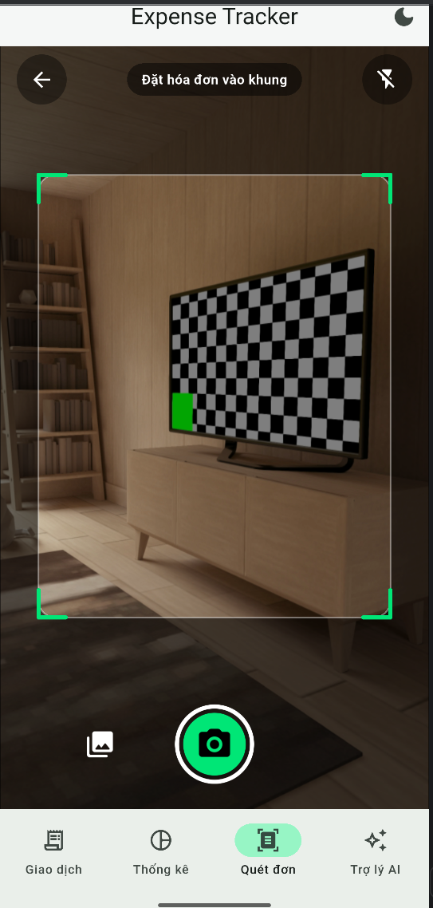

# MINI-PROJECT SHORT TECHNICAL REPORT
**Course:** Cross-Platform Mobile App Development (VKU)  
**Mini-Project Title:** Mini-Project 3: Expense Tracker with OCR Receipt Scanning  
**Team / Student Name:** [TODO: student name]  
**Submission Date:** [TODO: DD/MM/YYYY]  

---

## 1. GENERAL INFORMATION & DELIVERABLE LINKS
* **Team Members:**
  1. [TODO: Full Name] - Student ID: [TODO] - Role: [TODO: Developer / UI Designer] - Contribution: [TODO: 100%]
* **🔗 Live Demo URL:** [TODO: APK download link / Google Drive link]
* **💻 GitHub Repository:** https://github.com/lethihuonggiang-2907/danentang_project3
* **🎥 Video Demo (Optional):** [TODO: YouTube / Drive link, 2-3 min real receipt scan demonstration]

---

## 2. FEATURE IMPLEMENTATION CHECKLIST
| # | Required Feature | Status | Implementation Details & Acceptance Level |
|:---:|---|:---:|---|
| 1 | **Image Picking & Live Camera** | ✅ Complete | Live camera preview with `camera` package (`CameraScannerScreen`), tap-to-focus/exposure with animated ring (`FocusRingWidget`), 3-mode flash toggle (Off/Auto/Torch), crop-frame overlay (`CameraCropOverlay`), and gallery picker fallback (`image_picker`). |
| 2 | **On-Device Offline OCR** | ✅ Complete | Fully offline on-device text recognition using Google ML Kit (`google_mlkit_text_recognition`). Measures and logs processing time in milliseconds (`OcrScanResult.durationMs`). Generates and persists max-300px thumbnails in app documents directory. |
| 3 | **Vietnamese Heuristic Regex Extraction** | ✅ Complete | Pure Dart `ReceiptParser` (0 Flutter dependencies). Normalizes accents, parses Vietnamese VND currency formats (periods, commas, spaces), prioritizes total keywords, ignores VAT/change/discounts, corrects OCR character confusion (O↔0, l/I↔1), and extracts transaction dates with calendar validation and merchant/beneficiary names. |
| 4 | **Review & Edit Screen before Saving** | ✅ Complete | `ReceiptConfirmScreen` allows reviewing and modifying amount, date, category, merchant, and notes. Features live thousand-separator input formatting, displays thumbnail and OCR latency badge, and includes an expandable raw OCR text accordion for verification. |
| 5 | **SQLite Persistence & Category Filters** | ✅ Complete | `DatabaseHelper` and `TransactionRepository` using `sqflite` with parameterized queries, indices, and migration stubs. Transactions table stores `id`, `amount`, `date`, `merchant`, `category`, `note`, `thumbnail_path`, `created_at`. Deleting a transaction cleans up thumbnail files on disk. Includes swipe-to-delete with confirmation and category filter chips. |
| 6 | **CustomPainter Charts (No 3rd-party pkgs)** | ✅ Complete | Pure math `ChartGeometry` engine computing sweep angles summing to $2\pi$ and bar rectangles. Custom painters for Pie Chart, Donut Chart (with central total), and 7-day Weekly Bar Chart (with week navigation). Interactive tap selection, value pills, category legend, and entrance animations via `AnimationController`. |
| 7 | **Comprehensive Testing Suite** | ✅ Complete | 63 automated unit and widget tests covering ReceiptParser table-driven cases (33 simulated receipt & banking formats), ChartGeometry mathematical proofs, CropGeometry coordinate mapping, SQLite models, CustomPaint widgets, and Gemini mock HTTP calls. `flutter analyze` clean with 0 warnings/errors. |
| 8 | **Gemini AI Spending Assistant** | ✅ Complete | REST integration with Google Gemini (`gemini-1.5-flash`) using plain `http` and `connectivity_plus`. Injects API key via `--dart-define=GEMINI_API_KEY`. Strict privacy guard sends **only aggregated numerical statistics** (totals per category, daily sums, week-over-week change; never sends images, merchants, or notes). Evaluates spending level, analyzes changes, and suggests 2-3 weekly goals with offline and error handling. |

---

## 3. TECHNICAL ARCHITECTURE & PROJECT STRUCTURE

### 3.1 Architecture Overview
The application follows a **Feature-First Modular Architecture**, strictly adhering to Separation of Concerns:
* **`core/`**: Shared theme (Material 3 Light/Dark), constants, input formatters.
* **`data/`**: SQLite database helper, repository pattern, data models.
* **`features/`**: Independent feature modules (`scanner`, `extraction`, `transactions`, `charts`, `ai_assistant`).
  * `extraction/receipt_parser.dart` is written in **Pure Dart** with no Flutter imports to ensure deterministic unit testing.
  * `charts/geometry/chart_geometry.dart` is a **pure mathematical engine** separated from UI painting.

### 3.2 Framework, Engine & Embedder Architecture Layers
1. **Framework Layer (Dart):** Implements declarative UI widgets, state management (Riverpod), animation controllers, and high-level business logic.
2. **Engine Layer (C++):** Houses the graphics pipeline (Skia/Impeller), text layout (HarfBuzz), Dart Virtual Machine, and native Canvas drawing routines utilized by our `CustomPainter` and `PictureRecorder`.
3. **Embedder Layer (Platform Native - Java/Kotlin/Android NDK):** Connects the Flutter Engine to the Android OS, hosting the Camera2 API preview texture, local file storage, SQLite access via Android SQLite drivers, and Google ML Kit vision libraries.

---

## 4. EMPIRICAL EVIDENCE & SCREENSHOTS

> *Note: Placeholders below correspond to real device tests. Captured screenshots must be placed in `docs/screenshots/`.*

### Figure 1: Camera Scanner & Crop Frame Overlay
  
*Caption: Live camera preview featuring the darkened mask, emerald corner crop-frame overlay, tap-to-focus ring, and flash toggle.*  
`[TODO: Replace with real screenshot on Android phone]`

### Figure 2: OCR Extraction & Review Screen
  
*Caption: Receipt review screen showing thumbnail preview, on-device OCR latency badge (e.g. 78 ms), editable extracted fields, and expandable raw OCR text accordion.*  
`[TODO: Replace with real screenshot on Android phone]`

### Figure 3: Transaction List with Category Filter
  
*Caption: Transaction list screen displaying total spending banner, category filter chips, swipe-to-delete interaction, and thumbnail avatars.*  
`[TODO: Replace with real screenshot on Android phone]`

### Figure 4: Interactive CustomPainter Charts
  
*Caption: Custom-drawn Pie and 7-day Weekly Bar charts without 3rd-party libraries, highlighting selected slices with value tooltips and category legends.*  
`[TODO: Replace with real screenshot on Android phone]`

### Figure 5: Gemini AI Financial Assistant
  
*Caption: Gemini spending assistant screen displaying week selector, privacy disclosure pill, spending level rating badge, and actionable weekly financial goals.*  
`[TODO: Replace with real screenshot on Android phone]`

---

## 5. TECHNICAL CHALLENGES & RESOLUTIONS

### Challenge 1: Resilient Heuristic Regex Parsing of Vietnamese Receipts with OCR Noise
* **Problem:** Vietnamese receipts printed on thermal paper and mobile banking transfer screenshots present substantial OCR noise:
  1. Digits are frequently misrecognized by ML Kit (e.g. `O`/`o` instead of `0`, `l`/`I` instead of `1`, and random spaces inserted inside numbers like `1 50. 000`).
  2. Diverse currency formats (`150,000 VND`, `150.000đ`, `1.250.000 VNĐ`, `150000`).
  3. Misleading monetary lines (subtotals, VAT, customer payment, change returned) frequently have larger numbers than the actual total.
* **Resolution:**
  1. Implemented a Vietnamese diacritics stripping function (`_normalize`) mapping accented characters to ASCII uppercase for consistent keyword matching.
  2. Implemented iterative character sanitization replacing `O`/`o` and `l`/`I` when adjacent to digits or decimal points, and collapsing internal whitespace.
  3. Enforced prioritized keyword matching (`TỔNG CỘNG`, `TỔNG TIỀN`, `THÀNH TIỀN`, `TỔNG THANH TOÁN`, `SỐ TIỀN`, `TOTAL`, `AMOUNT`) while explicitly ignoring lines containing `VAT`, `THUẾ`, `TIỀN KHÁCH ĐƯA`, `TIỀN THỪA`, `GIẢM GIÁ`, `CHIẾT KHẤU`.
  4. Verified parsing correctness across 33 table-driven test cases covering Vietcombank, MB Bank, Techcombank, MoMo, and invalid calendar date rejection.

### Challenge 2: Pure Canvas Geometry & Coordinate Mapping Without External Chart Libraries
* **Problem:** The course project strictly prohibits external chart packages (e.g. `fl_chart`), requiring mathematical computation from scratch on Canvas:
  1. Ensuring the sum of sweep angles for Pie/Donut charts strictly equals $2\pi$ radians without floating-point drift or divide-by-zero crashes on empty/zero data.
  2. Detecting which slice or bar is tapped (`hit-testing`) in polar and Cartesian coordinate spaces.
  3. Mapping screen-space crop frames to image pixel rectangles during live camera capture across varying camera aspect ratios.
* **Resolution:**
  1. Created `ChartGeometry` which normalizes positive category sums and assigns the remainder $(2\pi - \sum \text{sweep}_{0..n-1})$ to the final slice, guaranteeing mathematical closure. Handled single-category ($2\pi$) and empty datasets cleanly.
  2. Formulated polar angle hit-testing via `atan2(dy, dx)` normalized relative to slice start angles, bounded by inner and outer radii.
  3. Created `CropGeometry.mapScreenCropToImagePixels` computing `BoxFit.cover` scale factors and coordinate clamping, verified through automated unit tests.
