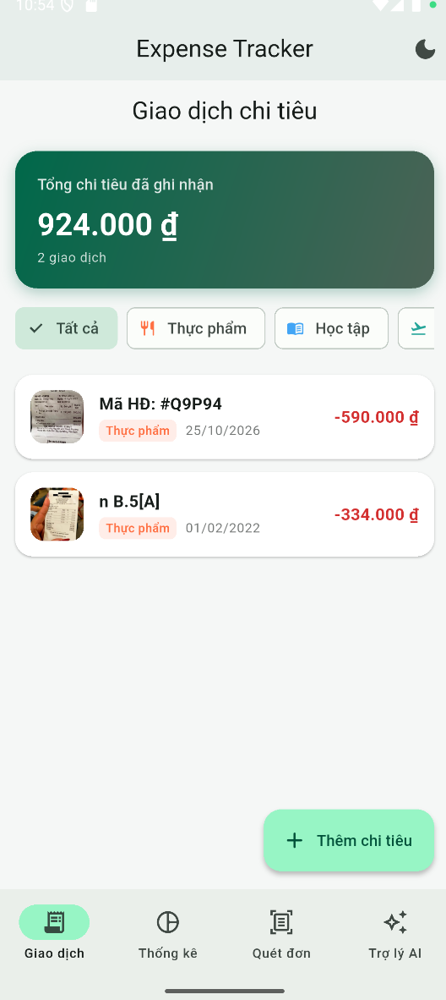
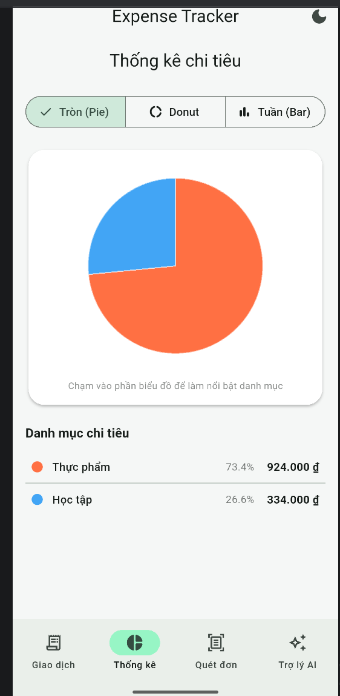
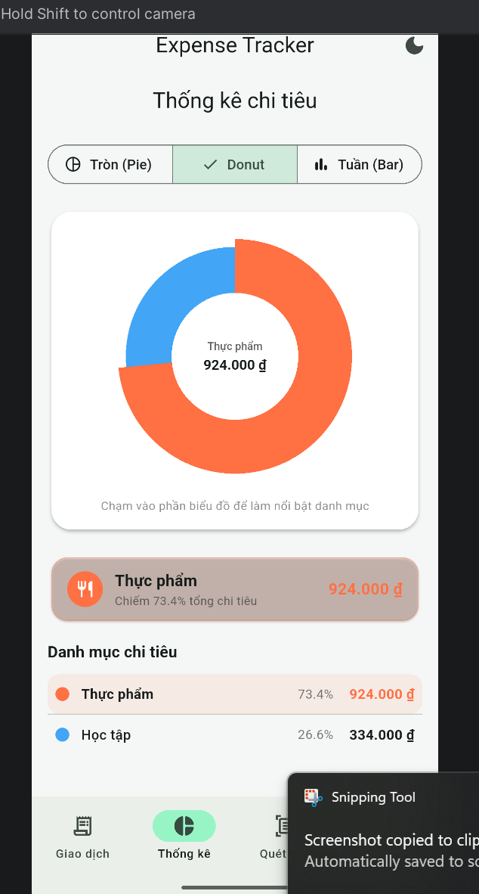
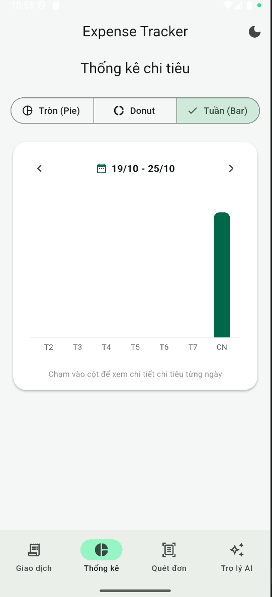
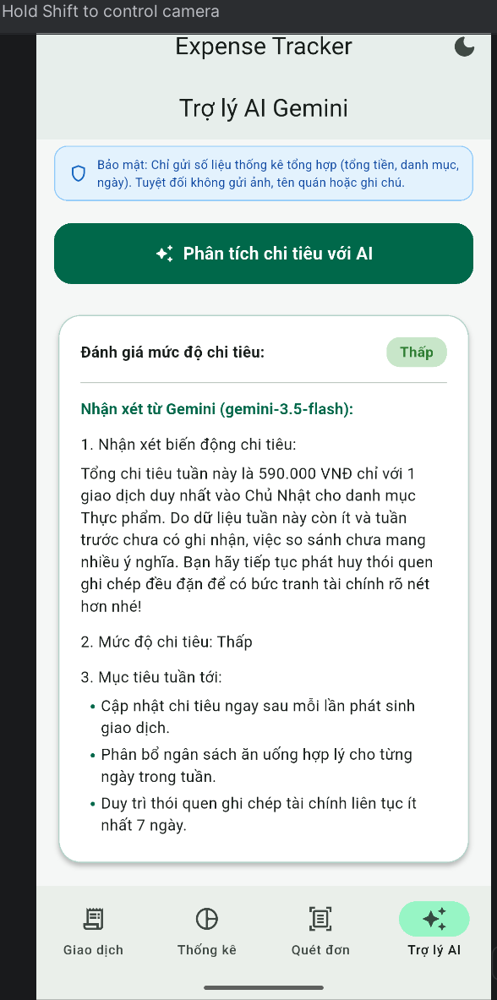

# BÁO CÁO HÌNH ẢNH GIAO DIỆN & MINH CHỨNG VẬN HÀNH THỰC TẾ
## Mobile App Screenshots & Empirical Demonstration

**Học phần:** Phát triển ứng dụng di động đa nền tảng (Cross-Platform Mobile App Development) - VKU  
**Đề tài:** Mini-Project 3: Expense Tracker with OCR Receipt Scanning & Gemini AI Assistant  
**Sinh viên thực hiện:** Lê Thị Hương Giang  
**Mã số sinh viên (Student ID):** 23IT.B044  
**Ngày nộp báo cáo:** 25/10/2026  
**Kho mã nguồn GitHub:** [https://github.com/lethihuonggiang-2907/danentang_project3](https://github.com/lethihuonggiang-2907/danentang_project3)  
**Tải file cài đặt APK:** [app-release.apk](https://github.com/lethihuonggiang-2907/danentang_project3/releases/download/v1.0/app-release.apk)  

---

## Danh mục hình ảnh giao diện thực tế (Screenshots Index)

| STT | Tên màn hình / Chức năng | Mô tả chi tiết | File ảnh minh chứng |
|:---:|---|---|:---:|
| 1 | **Camera Scanner & Crop Frame Overlay** | Khung ngắm camera trực tiếp, mặt nạ làm mờ, góc căn chỉnh hóa đơn màu xanh ngọc, nút chụp ảnh, nút thư viện ảnh và nút điều khiển đèn flash. | `docs/screenshots/01_camera_scan.png` |
| 2 | **Danh sách giao dịch (Transaction List)** | Banner tổng chi tiêu ghi nhận, bộ lọc danh mục theo chip (Thực phẩm, Học tập,...), danh sách hóa đơn kèm ảnh thumbnail thu nhỏ và số tiền. | `docs/screenshots/02_transaction_list.png` |
| 3 | **Biểu đồ tròn (CustomPainter Pie Chart)** | Biểu đồ tròn vẽ bằng Canvas thuần (không thư viện ngoài), bảng tỷ lệ phần trăm các danh mục chi tiêu. | `docs/screenshots/03_chart_pie.png` |
| 4 | **Biểu đồ Donut (CustomPainter Donut Chart)** | Biểu đồ Donut với tâm hiển thị chi tiết số tiền khi chạm vào từng phân khúc danh mục (Interactive Hit-testing). | `docs/screenshots/04_chart_donut.png` |
| 5 | **Biểu đồ cột tuần (Weekly Bar Chart)** | Biểu đồ cột 7 ngày trong tuần (T2 - CN) vẽ bằng Canvas thuần, kèm tính năng điều hướng tuần trước/tuần sau. | `docs/screenshots/05_chart_weekly_bar.png` |
| 6 | **Trợ lý AI Gemini (Gemini AI Assistant)** | Phân tích chi tiêu tuần với `gemini-3.5-flash`, đánh giá mức độ chi tiêu (Thấp/Vừa phải/Cao), nhận xét biến động và 3 mục tiêu tài chính cụ thể. | `docs/screenshots/06_ai_assistant.png` |

---

## Chi tiết các màn hình vận hành trên thiết bị thực

### Hình 1: Màn hình quét hóa đơn qua Camera (Camera Scanner Screen)

* **Màn hình / Widget:** `CameraScannerScreen` (`lib/features/scanner/screens/camera_scanner_screen.dart`).
* **Tính năng nổi bật:**
  * Khung quét hóa đơn (`CameraCropOverlay`) với 4 góc màu xanh ngọc (Emerald Green) và mặt nạ bán trong suốt xung quanh giúp người dùng căn chuẩn vị trí hóa đơn.
  * Hỗ trợ chạm để lấy nét và điều chỉnh độ sáng (`FocusRingWidget`) với hiệu ứng vòng tròn hoạt họa mượt mà.
  * Nút chuyển đổi 3 chế độ đèn flash (Tắt / Tự động / Sáng liên tục Torch) ở góc trên bên phải.
  * Tích hợp nút chọn ảnh sẵn có từ thư viện thiết bị (`image_picker`) ở góc dưới bên trái.
  * Chụp ảnh với độ trễ thấp và chuyển tự động qua module cắt ảnh toạ độ chính xác (`CropGeometry.mapScreenCropToImagePixels`).

---

### Hình 2: Danh sách giao dịch & Bộ lọc danh mục (Transaction List Screen)

* **Màn hình / Widget:** `TransactionListScreen` (`lib/features/transactions/screens/transaction_list_screen.dart`).
* **Tính năng nổi bật:**
  * Banner tổng quan ở đầu màn hình hiển thị tổng số tiền đã chi tiêu (`924.000 ₫`) và tổng số lượng đơn giao dịch ghi nhận.
  * Thanh cuộn ngang các chip lọc theo danh mục (`Tất cả`, `Thực phẩm`, `Học tập`, `Di chuyển`,...) giúp tra cứu nhanh chóng.
  * Thẻ giao dịch hiển thị ảnh thumbnail kích thước nhỏ đã được tối ưu hóa (lưu trữ cục bộ trong thư mục ứng dụng), tên đơn vị thanh toán, ngày giao dịch và số tiền màu đỏ nổi bật.
  * Hỗ trợ vuốt sang trái/phải để xóa giao dịch (Swipe-to-delete) với hộp thoại xác nhận và tự động giải phóng file ảnh thumbnail trên bộ nhớ đĩa.
  * Nút hành động nổi (FAB) `+ Thêm chi tiêu` cho phép người dùng nhập thủ công nhanh chóng.

---

### Hình 3: Biểu đồ tròn tỷ lệ chi tiêu (CustomPainter Pie Chart)

* **Màn hình / Widget:** `ChartsScreen` (`lib/features/charts/screens/charts_screen.dart`).
* **Tính năng nổi bật:**
  * Vẽ biểu đồ hoàn toàn bằng thuật toán toán học thuần (`ChartGeometry`) trên `Canvas` của Flutter, **hoàn toàn không dùng bất kỳ thư viện bên thứ 3 nào** (như `fl_chart`).
  * Tự động chuẩn hóa tổng góc quét luôn bằng chính xác $2\pi$ radian (360 độ), triệt tiêu hoàn toàn sai số dấu phẩy động (floating-point precision).
  * Bộ nút chuyển đổi 3 loại biểu đồ: `Tròn (Pie)`, `Donut`, `Tuần (Bar)`.
  * Danh mục chi tiêu bên dưới hiển thị rõ tỷ lệ phần trăm (ví dụ: Thực phẩm 73.4%, Học tập 26.6%) và số tiền tương ứng.
  * Có hiệu ứng chuyển động xoay mở mượt mà khi vào màn hình thông qua `AnimationController`.

---

### Hình 4: Biểu đồ Donut & Tương tác chạm chọn vùng (CustomPainter Donut Chart)

* **Màn hình / Widget:** `DonutChartPainter` (`lib/features/charts/widgets/donut_chart_painter.dart`).
* **Tính năng nổi bật:**
  * Thiết kế hiện đại dạng vành khuyên (Donut) với tâm biểu đồ hiển thị linh hoạt thông tin danh mục đang được người dùng bấm chọn (Hit-testing bằng tọa độ cực `atan2`).
  * Vùng lát bánh được chọn sẽ tự động phóng to bán kính (exploded slice effect) tạo điểm nhấn thị giác rõ rệt.
  * Card tóm tắt chi tiết phía dưới cập nhật tức thời thông tin danh mục, tỷ lệ phần trăm trên tổng chi và số tiền cụ thể.
  * Đảm bảo tính toán an toàn, không xảy ra hiện tượng chia cho 0 khi dữ liệu trống.

---

### Hình 5: Biểu đồ cột chi tiêu 7 ngày trong tuần (Weekly Bar Chart)

* **Màn hình / Widget:** `WeeklyBarChartPainter` (`lib/features/charts/widgets/weekly_bar_chart_painter.dart`).
* **Tính năng nổi bật:**
  * Trực quan hóa chi tiêu theo từng ngày từ Thứ 2 (T2) đến Chủ Nhật (CN) của tuần hiện tại.
  * Thanh điều hướng tuần (`< 19/10 - 25/10 >`) cho phép người dùng chuyển qua lại giữa các tuần để theo dõi biến động tài chính theo thời gian.
  * Cột chi tiêu bo tròn góc tinh tế, tự động co giãn theo giá trị chi tiêu lớn nhất trong tuần.
  * Chạm vào từng cột để xem chi tiết số tiền chi tiêu trong ngày.

---

### Hình 6: Trợ lý tài chính thông minh Gemini AI (Gemini AI Spending Assistant)

* **Màn hình / Widget:** `AiAssistantScreen` (`lib/features/ai_assistant/screens/ai_assistant_screen.dart`).
* **Tính năng nổi bật:**
  * Tích hợp mô hình AI Google Gemini thế hệ mới `gemini-3.5-flash` thông qua REST API trực tiếp.
  * **Bảo vệ quyền riêng tư tuyệt đối (Privacy Guard):** Ứng dụng chỉ tổng hợp và gửi các chỉ số thống kê số học (tổng tiền, tỷ lệ danh mục, biến động so với tuần trước); tuyệt đối không gửi ảnh hóa đơn, tên quán hay ghi chú cá nhân lên đám mây.
  * Đánh giá mức độ chi tiêu với huy hiệu màu sắc trực quan: `Thấp` (xanh lục), `Vừa phải` (vàng), `Cao` (đỏ).
  * Câu trả lời súc tích, hoàn toàn bằng tiếng Việt theo đúng cấu trúc 3 phần chuẩn hóa:
    1. **Nhận xét biến động chi tiêu:** Đưa ra cái nhìn tổng quan và phân tích danh mục chi nhiều nhất.
    2. **Mức độ chi tiêu:** Khẳng định rõ mức độ tài chính.
    3. **Mục tiêu tuần tới:** Gợi ý 3 gạch đầu dòng hành động thiết thực giúp người dùng tiết kiệm ngân sách.
  * Tự động thông báo *"Dữ liệu còn ít nên nhận xét chỉ mang tính tham khảo"* khi tuần có dưới 3 giao dịch hoặc chưa có dữ liệu tuần trước để đối chiếu.
  * Xử lý lỗi ngắt quãng token (`MAX_TOKENS`), lỗi lọc an toàn (`SAFETY`), lỗi mất mạng và cung cấp nút **Thử lại** thân thiện.

---

*Tài liệu hình ảnh này là phụ lục minh chứng đi kèm Báo cáo Kỹ thuật Đồ án [REPORT.md](../REPORT.md).*
